# Conceptual ERD

Status: **DRAFT ARCHITECTURE BASELINE**

This is a conceptual ERD. Physical schema details, indexes, constraints, and RLS policies are finalized per implementation phase.

```mermaid
erDiagram
    ORGANIZATIONS ||--o{ ORGANIZATION_NODES : contains
    ORGANIZATION_NODES ||--o{ ORGANIZATION_UNITS : contains
    PROFILES ||--o{ USER_ROLES : has
    ROLES ||--o{ USER_ROLES : assigned
    ROLES ||--o{ ROLE_PERMISSIONS : grants
    PERMISSIONS ||--o{ ROLE_PERMISSIONS : included
    PROFILES ||--o{ USER_SCOPE_ASSIGNMENTS : scoped
    DATA_SCOPES ||--o{ USER_SCOPE_ASSIGNMENTS : defines

    ORGANIZATIONS ||--o{ MEMBERS : owns
    MEMBERS ||--o{ MEMBER_STATUS_HISTORY : history
    MEMBERS ||--o{ MEMBER_CAPITAL_ACCOUNTS : capital
    MEMBERS ||--o{ SAVINGS_ACCOUNTS : savings
    MEMBERS ||--o{ LOAN_APPLICATIONS : applies
    MEMBERS ||--o{ LOAN_ACCOUNTS : borrows

    FINANCIAL_PRODUCTS ||--o{ FINANCIAL_PRODUCT_VERSIONS : versions
    FINANCIAL_PRODUCT_VERSIONS ||--o{ SAVINGS_ACCOUNTS : configures
    FINANCIAL_PRODUCT_VERSIONS ||--o{ LOAN_ACCOUNTS : configures
    SAVINGS_ACCOUNTS ||--o{ SAVINGS_TRANSACTIONS : posts
    LOAN_APPLICATIONS ||--o| LOAN_ACCOUNTS : becomes
    LOAN_ACCOUNTS ||--o{ LOAN_SCHEDULES : schedules
    LOAN_ACCOUNTS ||--o{ LOAN_PAYMENTS : receives

    PRODUCTS ||--o{ PRODUCT_UOMS : supports
    PRODUCTS ||--o{ INVENTORY_LOTS : stocked
    WAREHOUSES ||--o{ INVENTORY_LOTS : holds
    INVENTORY_LOTS ||--o{ INVENTORY_MOVEMENTS : moves

    SUPPLIERS ||--o{ PURCHASE_ORDERS : receives
    PURCHASE_ORDERS ||--o{ PURCHASE_ORDER_ITEMS : contains
    PURCHASE_ORDERS ||--o{ RECEIVINGS : fulfilled_by
    RECEIVINGS ||--o{ RECEIVING_ITEMS : contains
    PURCHASE_ORDERS ||--o{ SUPPLIER_INVOICES : invoiced

    SALES ||--o{ SALE_ITEMS : contains
    PRODUCTS ||--o{ SALE_ITEMS : sold

    JOURNALS ||--o{ JOURNAL_LINES : contains
    CHART_OF_ACCOUNTS ||--o{ JOURNAL_LINES : posts_to

    APPROVAL_INSTANCES ||--o{ APPROVAL_STEPS : has
    APPROVAL_STEPS ||--o{ APPROVAL_DECISIONS : decided

    RISKS ||--o{ CONTROLS : mitigated_by
    CONTROLS ||--o{ CONTROL_TESTS : tested
    CONTROL_TESTS ||--o{ AUDIT_FINDINGS : may_create

    DOCUMENTS ||--o{ DOCUMENT_VERSIONS : versions
    PROFILES ||--o{ AUDIT_LOGS : performs
```

## Important modeling decisions

1. Financial products are versioned; accounts reference the exact product version used at opening/disbursement.
2. Inventory movement is authoritative; balances are derived/maintained from controlled movements.
3. Accounting journal lines reference source transactions through source metadata/link tables in the physical schema.
4. Approval instances preserve the workflow/policy version that applied when submitted.
5. Audit logs are separate from business tables and are append-only from normal application flows.
6. Member cooperative-capital accounts and Simpan Pinjam savings accounts are separate domains.
